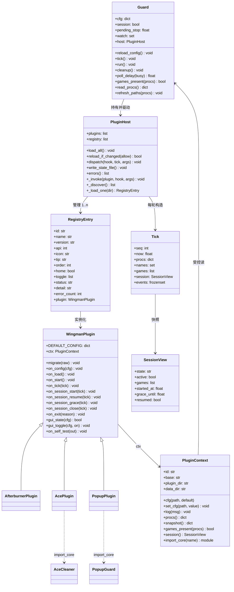
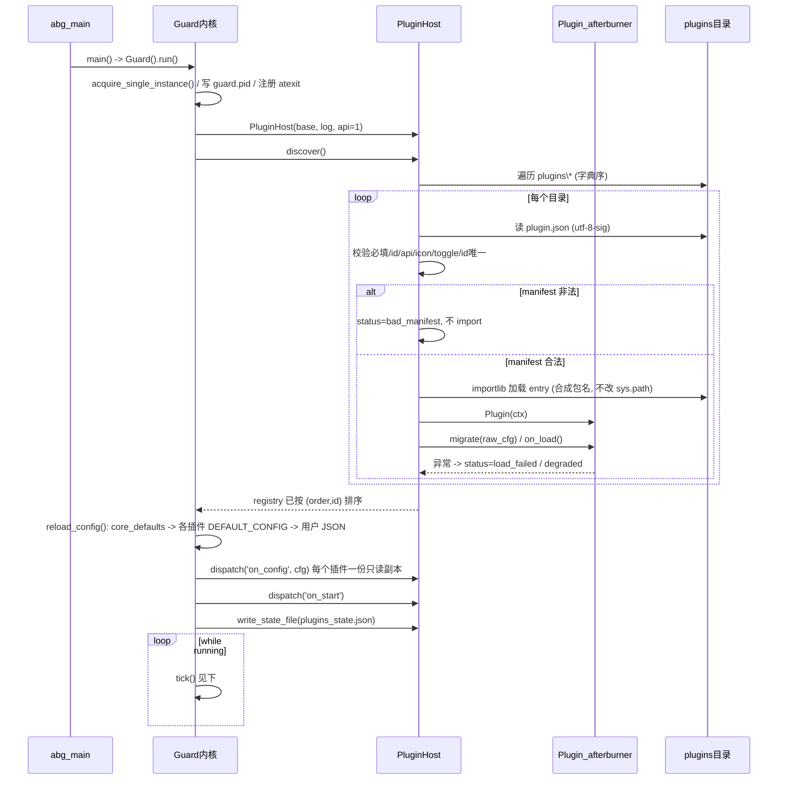
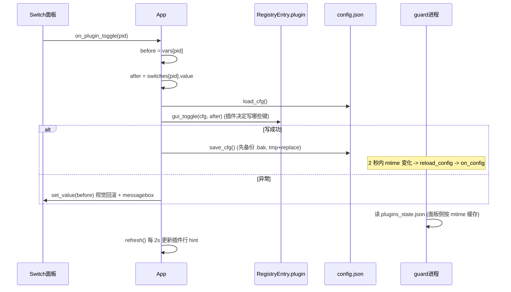
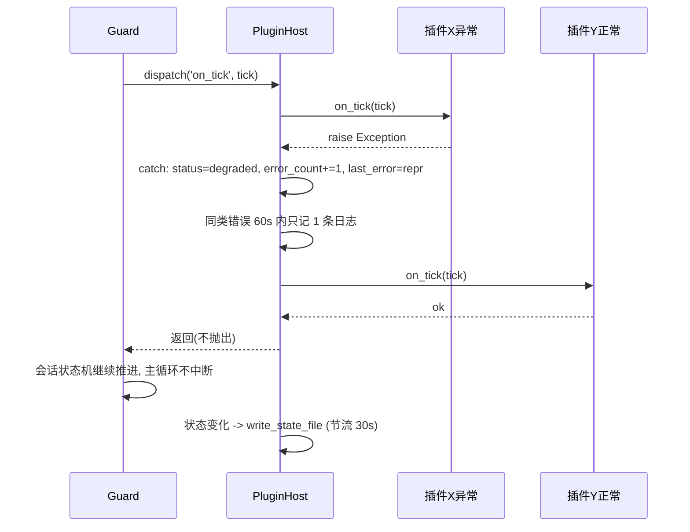

# 僚机 Wingman v2.0.0 插件架构设计

> 目标：把「小飞机关联启动 / ACE 防护 / 弹窗关闭」三个内置功能变成可插拔插件，用户把插件目录丢进 `plugins\` 就能加新功能。
> 约束：Python 3.8 + 仅标准库、PyInstaller onedir、旧 `config.json` 原样可用、ACE 四道闸门语义不变、单插件故障不影响守护、`plugins\` 为空也能跑。
> 本文只做设计，不含实现代码。实现由工程师按第 10 节顺序推进。
>
> **当前态注记（2026-11-22，WBOX v2.18.0）**：这是 v2.0.0 的历史设计稿，
> 大部分章节保留原貌。其中 `gui_menu_rows()` 契约与「浏览器式齿轮菜单」
> 已于 v2.18.0 删除（自 v2.10.0 起生产不可达）；设置入口统一是右上角
> 「设置」同窗换页，插件状态只由行尾状态点表达。第 10 节 S6 列的
> `test_gear_menu.py` / `test_plugin_gui_overflow.py` 同样已退役，
> 由 `test_menu_retired.py` 守卫。

---

## 0. 现状里与插件化直接冲突的地方（必须先改）

| 位置 | 现状 | 冲突点 | 替代做法 |
|---|---|---|---|
| `src\guard_core.py:1103-1223` `Guard.tick()` | 一个方法里把会话判定、小飞机启停、ACE 排队/限速、弹窗 arm/watch/tick 全串起来 | 三功能强耦合，无法增删功能 | 拆成「内核会话状态机 + 钩子分发」：会话迁移由内核算，功能动作交给 `on_session_*` / `on_tick` |
| `guard_core.py:586-646` `reload_config()` | 直接 `ace_native.AceCleaner(...)` / `popup_guard.PopupGuard(...)` 构造对象；650-665 行打印写死两个功能的摘要 | 内核知道具体功能 | 内核只做「内核默认值 + 各插件 `DEFAULT_CONFIG` + 用户 JSON」三段合并，然后 `on_config` 通知插件自建对象；摘要由插件自己 `ctx.log` |
| `guard_core.py:59/92/114/140` 四个默认值常量 | 挂在 `guard_core` 模块上 | 面板 `import guard_core` 只为取默认值（见 `settings_gui.py:29`），把 Win32 绑定也一起拉进面板进程；同时默认值若搬到 `plugins\`（可被替换的目录）就能静默削弱闸门 | 搬到新内核模块 `src\core_defaults.py`，`guard_core` 只做 re-export（保住 `test\test_throttle_state.py:119,137,145-148` 与 `test\test_popup_guard.py:219` 不改） |
| `guard_core.py:1225-1242` `cleanup()` | 只还原 `self.throttled` | 退出清理写死一个功能 | `on_exit('guard_stop')`，内核只负责 pid/stop.flag/atexit |
| `guard_core.py:1266-1272` `run()` 里 `self.popup.sweep('启动清理')` | 内核直接调弹窗库 | 同上 | `on_start()` 钩子 |
| `guard_core.py:1294-1359` `self_test()` | 逐项打印三功能状态 | 自检写死功能清单 | 内核打「插件表」+ 各插件 `on_self_test(out)` 追加自己的行 |
| `src\settings_gui.py:89-100` `FEATURES` | 硬编码三个 key/name/icon/tip | 主页行数固定 | 换成 `plugin_host.load_registry(BASE)` 的结果 |
| `settings_gui.py:58` `MENU_ROWS = 11` + `:1274-1318` `build_settings()` | 常量与手工 11 行一一对应 | 加插件就要改常量+改代码 | `build_settings()` 先构造 `rows` 规格列表再渲染，`self.menu_rows = len(rows)`；`MENU_ROWS` 改为 `expected_menu_rows()` 函数供自检/测试调用 |
| `settings_gui.py:781-786` `self.vars` | 硬编码 `ab/ace/popup` 三个 BooleanVar | 同上 | `self.vars[plugin_id]` 由 `plugin.gui_state(cfg)` 初始化 |
| `settings_gui.py:1042-1058` `build_main()` | `for feat in FEATURES` 后 `pack`，超过窗口高度就裁掉 | 行数多了会被切掉 | 超过 8 行时把行容器放进 Canvas + 滚轮（复用 `place_menu`:1192 的 `_bind_menu_wheel` 思路） |
| `settings_gui.py:1344-1371` `save_features()` / `:1373-1386` `on_toggle()` | 写死键名；ACE 一个开关写 `ace_cleanup.enabled` + `ace_throttle.enabled` 两处 | 插件无法声明自己的开关语义 | `plugin.gui_toggle(cfg, on)`，写哪些键由插件决定；内核只负责 `save_cfg` |
| `settings_gui.py:1218-1268` `menu_row(switch=True)` | 开关写死 `self.boot_var` / `on_boot_toggle`，且 `self.switches['boot']` 单键（`:1216` 关闭时 pop） | 插件行无法复用 | `menu_row(..., switch_var=None, switch_command=None, switch_key=None)` |
| `settings_gui.py:1502-1504` `self_check()` | 打印 `features=` / `rows=%d` 用的是写死常量 | 自检失真 | 打印注册表实际内容与 `app.menu_rows` |
| `src\abg.spec:73-76` `hiddenimports` | 只有 `guard_core/settings_gui/tkinter*` | 重构后 `guard_core` 不再 import `ace_native/popup_guard`，冻结后插件 `import ace_native` 会 `ModuleNotFoundError` | 显式加 `plugin_api, plugin_host, core_defaults, ace_native, popup_guard, game_lib` |
| `build_exe.bat`（xcopy 段） | 只把 `dist\Wingman\*` 拷进 `app\` | `plugins\` 不会进产物 | 只对内置 3 个 id 做增量 xcopy，**不删除** `app\plugins` 下其它目录 |
| `installer\setup_abg.py:588-625` `uninstall()` | `shutil.rmtree(target)` / 延时 `rmdir /s /q` 全删 | 用户自装插件一并删除，不可恢复 | 删除前把非内置插件目录备份到 `%LOCALAPPDATA%\Wingman\removed-plugins-<时间戳>\` |

> 结论：v2 不是「给现有代码套一层壳」，而是把 `Guard` 瘦身成内核（进程快照 / 会话状态机 / 配置热加载 / 主循环 / 日志 / 单实例），三个功能整体搬进 `plugins\`。

---

## 1. 目录与文件布局

```
<仓库根>\
├─ src\                          # 内核：全部冻进 exe
│  ├─ abg_main.py                # 入口，44 行保持不变（不再需要新增参数）
│  ├─ guard_core.py              # 内核守护：~700 行（原 1374 行瘦身）
│  ├─ core_defaults.py           # 新增：DEFAULTS / ACE_CLEANUP_DEFAULTS / POPUP_DEFAULTS / ACE_THROTTLE_DEFAULTS
│  ├─ plugin_api.py              # 新增：契约定义（纯 Python，无 Win32、无 tkinter、无副作用）
│  ├─ plugin_host.py             # 新增：发现 / 校验 / 加载 / 隔离 / 分发 / 状态落盘
│  ├─ ace_native.py              # 保留：ACE 低层库（服务启停、闸门实现）
│  ├─ popup_guard.py             # 保留：弹窗低层库（窗口枚举、宿主定位）
│  ├─ game_lib.py                # 保留：游戏库扫描（内核与小飞机插件共用）
│  ├─ settings_gui.py            # 面板：FEATURES→注册表、MENU_ROWS→动态
│  ├─ abg.spec / app.manifest / abg.ico
├─ plugins\                      # 随安装包分发，运行期从磁盘加载（不进 exe）
│  ├─ afterburner\
│  │   ├─ plugin.json
│  │   └─ plugin.py              # 小飞机 + RTSS 联动（原 744/806/842/863/890 行逻辑）
│  ├─ ace\
│  │   ├─ plugin.json
│  │   └─ plugin.py              # ACE 清理 + 运行时限速（原 927~1100 行逻辑）
│  └─ popup\
│      ├─ plugin.json
│      └─ plugin.py              # 弹窗拦截（原 tick 里的 popup 调用 + 启动 sweep）
├─ app\                          # 产物：Wingman.exe + _internal + plugins\ + config.json
├─ test\                         # 新增 6 个 test_plugin_*.py
├─ design\plugin-arch.md         # 本文
└─ installer\, build_exe.bat
```

约定：

1. **插件目录名 = 插件 id**（安装期强约束，加载期以 manifest 的 `id` 为准并检查两者一致，不一致只告警不拒绝，避免中文目录名场景误伤）。
2. 插件内**推荐单文件 `plugin.py`**；若拆多文件，宿主用合成包名 `wingman_plugin_<id>` 注册（`spec.submodule_search_locations=[plugin_dir]`），支持 `from . import helper`。
3. **绝不把插件目录加入 `sys.path`**：`plugins\x\json.py` 会污染整个进程的标准库导入，属可被利用的劫持面。
4. 插件状态/缓存文件：内置插件沿用旧路径（`ace_state.json` 在安装根，**不能动**，否则升级后冷却状态丢失可能立刻触发一次清理）；新插件写 `plugins\<id>\data\`（`ctx.data_dir`，宿主自动 `os.makedirs`）。
5. `plugins_state.json`（安装根，运行期由守护写、面板只读）：插件运行状态快照，见第 6.4 节。

### 1.1 内核 / 插件职责边界

| 能力 | 归属 | 理由 |
|---|---|---|
| 进程快照 `snapshot()`、`read_procs()`、`process_path()`、路径缓存 `refresh_paths()` | 内核 | 每轮只取一次，多插件共用；`None vs {}` 的语义（`guard_core.py:379-400`）是全局安全不变量 |
| 监控集合 `watch`、`path_is_game()`、`scan_roots()`、`refresh_lib()`、`games_present()` | 内核 | 「什么是游戏」是共享判定，三插件都依赖；口径不一致会误杀 |
| 会话状态机（`session` / `pending_stop` / `resuming` / `exit_grace_sec`） | 内核 | 跨插件共享的唯一时间轴；插件只读 |
| 配置热加载、默认值合并、`config.json` 写回 | 内核 | 单一写入口，避免多插件各写各的 |
| `log()` / 日志轮转 / 单实例互斥体 / `stop.flag` / `guard.pid` / `poll_delay()` / 主循环 | 内核 | 基础设施 |
| 时钟跳变检测 `check_clock_jump()` | 内核 | 影响所有闸门时间基准 |
| 小飞机启动/关闭/RTSS 清理/所有权 `ab_pid` | 插件 afterburner | 只与该功能相关 |
| ACE 四道闸门排队、限速状态集合 | 插件 ace | 只与该功能相关（闸门实现在 `ace_native`，仍在内核侧冻结） |
| 弹窗 arm / watch_early / sweep | 插件 popup | 只与该功能相关 |
| GUI 主页行、设置页行、开关写回 | 内核渲染 + 插件提供数据 | 面板不认识任何具体功能 |

---

## 2. `plugin.json`（manifest）字段表

放在 `plugins\<id>\plugin.json`，UTF-8（允许 BOM，读取用 `utf-8-sig`，与 `config.json` 一致）。

| 字段 | 类型 | 必填 | 缺省 | 缺省/异常行为 |
|---|---|---|---|---|
| `id` | string | 是 | — | 必须匹配 `^[a-z][a-z0-9_]{1,31}$`；缺失或非法 → 该目录跳过，状态 `bad_manifest`，其余插件照常加载 |
| `name` | string | 是 | — | 中文显示名（主页行、自检行、日志）。缺失 → 用 `id` 兜底并记一条警告 |
| `version` | string | 是 | — | `x.y.z`，仅展示与日志，不参与兼容判断 |
| `api` | int | 是 | — | 依赖的插件 API 主版本。见第 4 节 |
| `entry` | string | 否 | `plugin.py:Plugin` | `文件名:类名`。文件不存在 / 类不存在 → `load_failed` |
| `icon` | string | 否 | `dot` | 必须命中图标白名单（`Glyph.draw` 现有分支，见 `settings_gui.py:579-670`）：`link/shield/block/dot/play/stop/boot/rescan/log/cfg/sun/moon/check/close`。未知值 → `dot`（`Glyph` 无 else 分支，画不出来就是空白，必须兜底） |
| `tip` | string | 否 | `''` | 主页悬停简介，允许 `\n`。空则不挂 ToolTip |
| `order` | int | 否 | `100` | 主页排序，小在前；同值按 `id` 字典序，保证顺序确定 |
| `home` | bool | 否 | `true` | 是否在主页出现「名称 + 开关」行。`false` 的插件不占主页，仍留在注册表里由自检列出 |
| `admin` | bool | 否 | `false` | 仅用于面板文案（该类插件需要管理员权限才生效），守护进程恒为管理员 |
| `toggle` | string[] | 否 | `["<id>_enabled"]` | 开关的配置路径（点号分隔，如 `["ace_cleanup.enabled","ace_throttle.enabled"]`）。读 = 全部为真才算开；写 = 全部写成同一个值。空数组 = 该插件无开关，强制 `home=false` |
| `config.defaults` | object | 否 | `{}` | 仅在插件类**没有** `DEFAULT_CONFIG` 时作为兜底。**权威来源是 `plugin.py` 的 `DEFAULT_CONFIG`**，原因见第 4.3 节 |
| `config.keys` | string[] | 否 | `[]` | 纯展示用途：面板「编辑配置文件」旁可列出该插件用到的键（帮助用户知道改哪几行），不参与合并 |
| `requires` | string[] | 否 | `[]` | 依赖的其它插件 id；被依赖插件未加载成功时本插件不加载（用于将来「A 插件增强 B 插件」的场景，v2 内置插件都不用） |

### 2.1 `afterburner` 完整示例

`plugins\afterburner\plugin.json`：

```json
{
  "id": "afterburner",
  "name": "小飞机关联启动",
  "version": "2.0.0",
  "api": 1,
  "entry": "plugin.py:Plugin",
  "icon": "link",
  "tip": "检测到游戏启动时自动拉起 MSI Afterburner（含 RTSS 监控），\n游戏退出后按配置一并关闭。切换即时生效。",
  "order": 10,
  "home": true,
  "admin": true,
  "toggle": ["afterburner_enabled"],
  "config": {
    "keys": [
      "afterburner_enabled", "afterburner_path", "rtss_processes",
      "manage_rtss", "force_close", "close_wait_sec"
    ],
    "defaults": {}
  },
  "requires": []
}
```

对应的 `plugins\afterburner\plugin.py` 只声明默认值（`DEFAULT_CONFIG`）与钩子，`afterburner_path` / `rtss_processes` 等默认值从 `core_defaults.DEFAULTS` 引用，保证与 v1.3.1 完全一致：

```python
# plugins/afterburner/plugin.py（节选，示意签名，不是完整实现）
import core_defaults as core
from plugin_api import WingmanPlugin

class Plugin(WingmanPlugin):
    DEFAULT_CONFIG = {
        'afterburner_enabled': core.DEFAULTS['afterburner_enabled'],  # True
        'afterburner_path': core.DEFAULTS['afterburner_path'],        # ''
        'rtss_processes': list(core.DEFAULTS['rtss_processes']),
        'manage_rtss': True,
        'force_close': True,
        'close_wait_sec': 6,
    }
```

---

## 3. 插件基类与钩子契约

`src\plugin_api.py` 只放定义（无副作用、可被面板与测试直接 import）。

### 3.1 上下文对象 `ctx`

```python
# plugin_api.py
API_VERSION = 1
ICON_WHITELIST = frozenset(('link', 'shield', 'block', 'dot', 'play', 'stop',
                            'boot', 'rescan', 'log', 'cfg', 'sun', 'moon',
                            'check', 'close'))

class SessionView(object):
    """会话只读视图（持有者：内核）。插件不得修改。"""
    state: str          # 'idle' | 'active' | 'grace'
    active: bool        # state == 'active'
    games: list         # 本轮识别到的游戏名（小写、有序）
    started_at: float   # 本局会话开始墙钟；idle 时为 0.0
    grace_until: float  # state == 'grace' 时，宽限到期时刻；否则 0.0
    resumed: bool       # 本局是否经历过「闪断后恢复」

class PluginContext(object):
    """每个插件实例一个，只暴露受控能力。"""
    id: str
    base: str            # 安装根目录（config.json/guard.log 所在）
    plugin_dir: str      # plugins\<id>
    data_dir: str        # plugins\<id>\data（宿主已 makedirs）
    api: int             # 内核提供的 API 版本

    def cfg(self, path, default=None): ...
        # 读自己的（或内核的）配置，path 支持点号：ctx.cfg('ace_cleanup.grace_sec', 180)

    def set_cfg(self, path, value): ...
        # 只允许写自己 manifest 里 toggle / config.keys 声明的路径，越权抛 PermissionError

    def log(self, msg): ...
        # 自动加 '[<id>] ' 前缀后写 guard.log（走内核同一个 log，保留轮转）

    def procs(self): ...
        # 本轮进程表 {pid: name}；本轮快照失败时返回 None（插件必须把 None 当"未知"，不得当空表）

    def snapshot(self): ...
        # 现取一份进程表（用于关闭流程里同步复核）；失败返回 None

    def process_path(self, pid): ...        # 复用内核 path_cache
    def refresh_paths(self, procs): ...
    def games_present(self, procs=None): ...  # 内核判定：白名单 + 路径兜底；取不到表返回 True
    def watch_names(self): ...                # 当前监控的进程名集合（小写）
    def session(self): ...                    # -> SessionView
    def now(self): ...                        # 本轮 tick 的墙钟（同一轮内恒定，便于离线断言）
    def import_core(self, name): ...
        # 取内核低层库：'ace_native' / 'popup_guard' / 'game_lib'；未知名字抛 KeyError
        # 用于让插件无需 sys.path 也能拿到共享实现（冻结后同样可用）

    def write_state(self, name, obj): ...     # 原子写 data_dir\<name>.json（tmp + os.replace）
    def read_state(self, name, default=None): ...
    def set_status(self, text, level='ok'): ...  # 面板「插件」分组显示的一行摘要
```

`ctx` 的设计原则：**能力最小化 + 只读为主**。插件拿不到 `Guard` 实例、拿不到 `cfg` 整体字典（避免 `cfg['afterburner_enabled']=False` 这种越权写），也拿不到 `subprocess` 的封装（要起进程自己 import，行为可审计）。

### 3.2 基类与钩子

```python
class WingmanPlugin(object):
    DEFAULT_CONFIG = {}       # {顶层键: 默认值}；dict 段由内核 deep-merge 用户配置
    API = 1                   # 插件实现所遵循的 API 版本（与 manifest.api 一致）

    def __init__(self, ctx): self.ctx = ctx

    # ---- 配置 ----
    def migrate(self, raw): ...
        """可选。配置加载时、合并默认值之前调用一次（每次守护进程启动）。
        raw 是 config.json 的原始 dict，可直接原地改写（改名/搬段）。
        只允许动自己命名空间内的键。异常 = 记日志并忽略迁移。"""

    def on_config(self, cfg): ...
        """必选（可空实现）。首次加载 + 每次 config.json mtime 变化后调用。
        cfg 是本插件的合并结果（已含默认值），只读副本。
        插件在此重建自己的低层对象（如 AceCleaner/PopupGuard），须轻量（<50ms）。"""

    # ---- 生命周期 ----
    def on_load(self): ...
        """插件加载成功、migrate/on_config 之后调用一次。可做一次性的目录检查。"""

    def on_start(self): ...
        """守护主循环开始前调用（guard.pid 已写、stop.flag 已清）。
        原 popup 的启动清理（guard_core.py:1266-1272）在这里做。"""

    def on_tick(self, tick): ...
        """每轮调用，**必然最后调用**，且在 on_session_* 之后。
        tick: Tick(seq, now, procs, names, games, session, events)"""

    # ---- 会话事件（每个迁移点最多一个，顺序见 §3.4）----
    def on_session_start(self, tick): ...
        """idle -> active（新会话）。原 1171-1191 行分支。"""

    def on_session_resume(self, tick): ...
        """grace -> active（宽限期内游戏闪断后回来）。原 1168-1170 行分支。
        语义差异：不重开会话、不重置小飞机所有权/RTSS 基线，只取消排队中的清理/监视。"""

    def on_session_grace(self, tick): ...
        """active -> grace（游戏全部退出，进入 exit_grace_sec 宽限）。
        原 1200-1208 行分支（pending_stop / queue_ace / popup.arm）。"""

    def on_session_close(self, tick): ...
        """grace -> idle（宽限到期且游戏确实没回来）。原 1209-1211 行（close_owned）。"""

    def on_exit(self, reason): ...
        """退出清理。reason ∈ {'guard_stop', 'reload', 'fatal'}。
        原 1225-1242 行（还原 ACE 优先级）。禁止阻塞超过 2 秒。"""

    # ---- 面板（在**面板进程**内调用，不在守护进程）----
    def gui_state(self, cfg): ...        # -> bool，开关初始状态（默认实现：按 manifest.toggle 全真为真）
    def gui_toggle(self, cfg, on): ...   # 把开关写进 cfg（内存），内核负责 save_cfg；默认实现按 toggle 路径写
    # v2.18.0 删除：gui_menu_rows(cfg) 曾插入齿轮菜单「插件」分组，契约已退役

    # ---- 自检 ----
    def on_self_test(self, out): ...
        """--self-test 时调用，out 是 list，插件 append 自己的诊断行（纯文本）。"""
```

### 3.3 异常处理约定

| 场景 | 宿主行为 |
|---|---|
| `plugin.json` 读不出 / JSON 坏 / 必填缺失 / `api` 不支持 | 该目录不加载，状态 `bad_manifest` + `detail`；**不 import 插件代码** |
| `entry` 文件或类不存在、导入期抛异常、`__init__` 抛异常 | 状态 `load_failed` + 异常摘要；日志一行；其余插件照常 |
| `on_config` / `on_load` / `on_start` 抛异常 | 采集异常，状态 `degraded`；**该插件后续钩子仍然调用**（可能是暂时性故障，如文件被占用），但同类异常 60 秒内只记一条日志 |
| `on_tick` / `on_session_*` 抛异常 | 采集异常，`error_count += 1`，状态 `degraded`；本轮直接跳到下一个插件；会话状态机继续推进（内核状态与插件状态解耦，绝不因插件异常把 `session` 卡死） |
| `on_exit` 抛异常 | 采集，吞掉；继续调下一个插件的 `on_exit`；不阻止守护退出 |
| 单次钩子耗时 > `hook_warn_sec`（默认 5s） | 记一条警告（含插件 id、钩子名、耗时）。Python 无法安全中断同步调用，因此**只告警不终止** |
| 同一插件 `on_tick` 连续失败 ≥ 10 次 | 降级为每 30 轮调用一次（避免刷日志 + 拖慢主循环），下次成功即恢复每轮 |

所有钩子调用都经 `PluginHost._invoke(plugin, hook_name, *args)`：`try/except BaseException`（仅 `KeyboardInterrupt/SystemExit` 例外不再抛，因为守护是后台进程，`SystemExit` 由插件主动退出会带走整个守护，必须拦）。插件不得调用 `sys.exit()`——文档写明，且拦 `SystemExit`。

### 3.4 一轮 tick 的确定性顺序

```
① reload_config()                     # mtime 变了才做
② 取进程表（procs=None 时按 v1 逻辑跳过本轮，见 guard_core.py:1127-1137）
③ 算 games / session 迁移
④ dispatch: 会话钩子（本轮流最多 1 个）
⑤ dispatch: on_tick（所有插件）
⑥ 睡 poll_delay(busy)
```

- 会话钩子先于 `on_tick`：保持 v1 语义（先 `begin_session()` / `arm()`，最后才 `popup.tick()`）。
- 插件遍历顺序 = `(order, id)`；同 order 用 id 字典序，**永不依赖加载顺序或目录枚举顺序**（目录枚举顺序在 NTFS 上不保证稳定）。

### 3.5 类图



### 3.6 调用流程

**（1）守护启动 + 插件加载**



**（2）每轮 tick 与会话迁移**

```mermaid
sequenceDiagram
    participant G as Guard内核
    participant H as PluginHost
    participant A as afterburner
    participant C as ace
    participant U as popup

    G->>G: reload_config() (mtime 变了才做)
    G->>G: procs = read_procs()
    alt procs is None
        G->>G: 连续失败不足 3 次则跳过本轮, 否则沿用 last_procs
    end
    G->>G: games = watch ∩ names + 路径兜底
    alt games 非空 且 !session
        G->>G: state=active (resuming ? resumed=true)
        G->>H: dispatch on_session_start / on_session_resume
        H->>A: launch_afterburner() / 保留所有权
        H->>C: ace_touched=false
        H->>U: begin_session()
    else games 为空 且 session
        G->>G: state=grace, grace_until=now+exit_grace_sec
        G->>H: dispatch on_session_grace
        H->>C: queue_ace(now) (未出现ACE则跳过)
        H->>U: arm(now, procs) -> sweep + 拍窗口基线
    else grace 到期且 games 仍为空
        G->>G: state=idle
        G->>H: dispatch on_session_close
        H->>A: close_owned() (取表失败 -> ctx.retry_close(2) 回 grace)
    end
    G->>H: dispatch on_tick(tick) 全部插件
    H->>C: cleaner.observe() / tick_throttle() / tick_ace()
    H->>U: session.active ? watch_early(procs) ; tick(now, procs)
    G->>G: sleep poll_delay(busy)
```

**（3）面板开关写回**



**（4）单插件抛异常时的隔离**



---

## 4. 兼容与版本

### 4.1 `api` 版本号规则

- 整数、**只表示主版本**，`API_VERSION = 1`（v2.0.0 首发）。
- 加载条件：`1 <= manifest.api <= API_VERSION`。
  - `api > API_VERSION` → 拒绝加载，状态 `too_new`，面板显示「需要更新版本的内核」。老用户装了新插件不会崩，只会看到一行提示。
  - `api < API_VERSION` → 以**兼容模式**加载：内核补齐旧版本字段（新增钩子作空实现，`ctx` 只暴露旧版本已有的方法），并在日志打一行 `插件 X 按 api=1 兼容模式运行`。
  - **硬约束**：API 主版本 +1 时，内核必须至少保留上一主版本的字段与钩子名一整年/一个大版本；破坏性改动只能通过「新增钩子 + 老钩子标记弃用」渐进完成，不允许删除。
- `manifest.version`（插件自身版本）与 `api` 无关，仅用于展示与日志。

### 4.2 插件 id 冲突

- 扫描顺序：`plugins\*` 目录名字典序。同一 `id` 先加载者胜出，后来的状态 `conflict` + `detail="id 与 plugins\\<其它目录> 冲突"`，不 import。
- 目录名 ≠ `id` 时，以 `id` 为准并记一条警告（便于用户把目录改对）。
- 内置三 id（`afterburner` / `ace` / `popup`）**不做特殊保护**：用户可以删目录禁用，也可以整目录替换成自己写的实现。理由：用户诉求是「按自己的需要增删插件」，硬编码白名单会直接违背需求；替换带来的信任风险在第 9 节说明并由签名/权限层面缓解。

### 4.3 默认值的唯一来源（为什么不放 manifest）

`guard_core.py:138-139` 的注释已经踩过这个坑：`config` 缺段时若守护、面板、自检各写各的 `.get(k, default)`，会出现「面板显示开、守护实际关」。

v2 的规则：

1. **内核键**（`game_processes`/`game_roots`/`poll_*`/`exit_grace_sec`/`log_max_kb`/`ui_theme`/`min_game_exe_mb`…）默认值只在 `src\core_defaults.py` 的 `DEFAULTS`。
2. **插件键**默认值只在 `plugin.py` 的 `DEFAULT_CONFIG`（Python 代码，可被测试 import 断言；`plugins\ace` 直接引用 `core_defaults` 里的闸门秒数）。
3. `manifest.config.defaults` 只在插件类没有 `DEFAULT_CONFIG` 时兜底，且加载后会打一条「插件 X 用 manifest 默认值」的日志，提示作者搬到 Python。
4. **安全默认值（ACE 四道闸门秒数、`protect_names`）必须来自内核冻结的 `core_defaults`**，不来自 `plugins\`：插件目录可被替换，默认值不能跟着一起被替换。

### 4.4 配置键命名与迁移规则

| 规则 | 内容 |
|---|---|
| 旧键一律不改名 | 现有 30 键（`app\config.json`）一个都不改名、不删除：`afterburner_enabled`、`afterburner_path`、`rtss_processes`、`game_processes`、`game_roots`、`exclude_*`、`min_game_exe_mb`、`max_scan_depth`、`poll_*`、`exit_grace_sec`、`close_wait_sec`、`force_close`、`manage_rtss`、`rescan_roots_sec`、`log_max_kb`、`game_lib{}`、`ace_cleanup{}`、`ace_throttle{}`、`popup_guard{}`、`ui_theme`、`_说明` 类中文说明键 |
| 新插件命名空间 | 开关布尔键用 `<id>_enabled`；复杂配置用 `<id>` 子字典（内含 `enabled`）。如 `screenshot_enabled` / `screenshot{...}` |
| 保留键 | 插件不得声明 `game_processes / game_roots / exclude_* / poll_* / exit_grace_sec / log_max_kb / ui_theme / _*` 这些内核键；冲突时内核拒绝该条声明并记日志，插件仍加载但不写该键 |
| 插件被删除 | 其配置键**保留在 config.json**，不清理。理由：重装插件后参数还在；且面板保存是全量重写，主动裁剪键等于帮用户删数据 |
| 未知键 | 一律原样保留（`save_cfg` 只打补丁不改结构，沿用 v1 行为） |
| 段级迁移 | 插件可选 `migrate(raw)`；v1 的 `ace_guard → ace_cleanup` 迁移（`guard_core.py:605-615`）搬进 `plugins\ace\plugin.py`，行为逐字保留 |
| 文字说明键 | v2 新增 `_插件` 说明键（讲插件目录怎么放），旧 `_开关` 文案里「三个功能」的说法在迁移中改写为「已加载的插件」，其余中文键原样保留 |
| 升级合并 | 安装器 `merge_config()`（`installer\setup_abg.py:408`）已按「旧值优先 + 补新增项」工作，插件新增键会自动补齐，无需改 |

---

## 5. 三个功能的迁移映射

### 5.1 函数 / 状态 → 归属

| 现有位置（`src\guard_core.py`） | 归属 | 说明 |
|---|---|---|
| `snapshot()` 379 / `read_procs()` 791 / `refresh_paths()` 544 / `process_path()` 364 / `path_is_game()` 562 / `games_present()` 842 / `scan_roots()` 508 / `refresh_lib()` 667 / `rtss_names()` 555 | **内核** | 通过 `ctx.procs()/games_present()/watch_names()` 暴露；`rtss_names()` 随 RTSS 概念一起搬进 afterburner（小飞机专属），内核不再有 RTSS 知识 |
| `check_clock_jump()` 698 | 内核 | |
| `reload_config()` 586 | 内核（拆三段：内核默认值 / 插件默认值 / 用户 JSON） | 摘要日志改由插件 `on_config` 自己打 |
| `poll_delay()` 1244 / `run()` 1250 / `cleanup()` 1225 | 内核 | `cleanup` 只剩 pid/flag 清理 + `dispatch('on_exit')` |
| `launch_afterburner()` 744 / `check_exe_dir()` 715 | **afterburner 插件** | `check_exe_dir` 的 ACL 告警语义原样保留（属提权安全提示） |
| `close_owned()` 863 / `close_pid()` 806 / `close_rtss_family()` 890 | **afterburner 插件** | `close_pid` 的「等待中复核游戏是否回来」逻辑（818-835）必须逐字保留 |
| 状态：`ab_pid` / `ab_by_name` / `rtss_baseline` / `next_launch` / `close_noted` | **afterburner 插件私有** | 不暴露给其它插件；「小飞机所有权」是单插件概念 |
| `queue_ace()` 927 / `tick_ace()` 943 / `ace_watch_names()` 981 | **ace 插件** | |
| `throttle_cfg()` 990 / `throttle_targets()` 998 / `tick_throttle()` 1005 | **ace 插件** | |
| 状态：`ace_pending` / `ace_exit_at` / `ace_next_check` / `ace_verdict` / `cleaner` / `ace_seen` / `throttled` / `throttle_tried` / `throttle_retry` / `ace_touched` / `restore_noted` / `update_block_noted` / `priv_noted` | **ace 插件私有** | 全部迁走，内核不再持有 |
| `tick()` 内的 popup 调用（1165/1177/1208/1214-1218/1222）、启动 sweep（1266-1272） | **popup 插件** | |
| 状态：`popup` 实例 | **popup 插件私有** | |
| 会话状态：`session` / `pending_stop` / `last_games` / `last_procs` / `snap_fails` | **内核** | 跨插件共享，只读视图 `SessionView` |
| `ace_native.AceCleaner` / `popup_guard.PopupGuard` | 保留在 `src\` 作为共享低层库，由插件 `ctx.import_core()` 取用 | 安全实现集中在一处、随 exe 冻结，插件无法用自己那份逻辑绕过闸门 |

### 5.2 Getters / Setters —— 内核暴露的只读接口

| 名称 | 类型 | 谁需要 | 说明 |
|---|---|---|---|
| `ctx.session().state` | `'idle'\|'active'\|'grace'` | 三插件 | 对应 v1 的 `session` 布尔 + `pending_stop` 非空 |
| `ctx.session().games` | `list[str]` | 三插件 | 本轮游戏名 |
| `ctx.session().grace_until` | `float` | afterburner | 宽限到期时刻（`pending_stop`） |
| `ctx.session().resumed` | `bool` | afterburner / popup | 本局是否闪断恢复过（决定 `begin_session()` 是否清零计数） |
| `ctx.procs()` / `ctx.snapshot()` | `dict\|None` | 三插件 | **必须区分 None 与 {}**，v1 的安全不变量 |
| `ctx.watch_names()` | `set` | 插件判断"这是不是游戏" | v1 的 `self.watch` |
| `ctx.games_present(procs=None)` | `bool` | afterburner / popup | v1 同名方法；取不到表返回 True |
| `ctx.import_core('ace_native')` | `module` | ace | |

### 5.3 每个插件的钩子落地

**afterburner**

| 钩子 | 做什么 | 对应 v1 |
|---|---|---|
| `on_config` | 读 `afterburner_path/rtss_processes/manage_rtss/force_close/close_wait_sec`，缓存 | 745-768 |
| `on_session_start` | 若 `ab_pid` 已存在且仍在跑 → 接管；若小飞机非本插件启动 → 不接管；否则按 `afterburner_enabled` 决定是否 `launch`，失败 `next_launch = now+60` | 1179-1191 |
| `on_session_resume` | 只做「保留所有权」的日志，不重启、不重设基线 | 1168-1170 |
| `on_session_grace` | 只打日志（v1 的 `游戏已全部退出，N 秒后关闭小飞机` 由内核打，因为是通用会话文案） | 1200-1205 |
| `on_session_close` | `close_owned()`：取表失败则 `pending_stop` 回退 2 秒重试（v1 语义：**不能让内核直接进 idle**，需要"重试"能力） | 863-888, 1209-1211 |
| `on_tick` | 会话中检测 `ab_pid` 中途退出 → 放弃接管 | 1192-1195 |

> ⚠️ `pending_stop` 回退重试是 v1 的隐性行为（`guard_core.py:867`）。内核需要提供 `ctx.retry_close(delay=2)`：把会话从 `idle` 拉回 `grace` 一次并标记 `close_retry`，否则取表失败那一轮小飞机就再也关不掉了。**这是本次迁移最容易漏的一条语义**。

**ace**

| 钩子 | 做什么 | 对应 v1 |
|---|---|---|
| `migrate(raw)` | `ace_guard → ace_cleanup` 迁移 | 605-615 |
| `on_config` | 重建 `AceCleaner(cfg, log, base/ace_state.json, games_present=ctx.games_present)`，`_snapshot_impl = ctx.snapshot` | 639-642 |
| `on_tick` | ①`cleaner.observe(procs, now)`（闸门 4 基准，**游戏期间也要观察**）②`tick_throttle(now, procs)` ③`tick_ace(now, names)` | 1140-1143, 1220-1221 |
| `on_session_start` | `ace_touched=False`、`restore_noted=False`；记录「本局是否出现 ACE」（每轮在 `on_tick` 里维护 `ace_touched`） | 1173-1174, 1196-1197 |
| `on_session_resume` | 取消排队：`ace_pending=False` + 日志「游戏会话继续，取消 ACE 清理调度」 | 1162-1164 |
| `on_session_grace` | `queue_ace(now)`；若本局没出现 ACE → 跳过并记日志 | 927-941, 1206 |
| `on_session_close` | 语境界限：**限速还原发生在"会话彻底结束"**（v1 里是 `not session and pending_stop is None`）。内核在 `on_session_close` 里先调 `on_session_close` 再调一次 `on_tick` 即可覆盖 | 1027-1043 |
| `on_exit` | 还原所有 `throttled` 优先级 | 1227-1232 |

**四道闸门语义保持清单**（迁移后必须逐条回归）：

| 闸门 | 语义 | 落点 |
|---|---|---|
| Grace 180s | 游戏退出后等 180 秒 | `ace_native.AceCleaner.verdict()`（未改） |
| AceAge 300s | ACE 进程自身存活 ≥ 300s；`process_age_sec()` 返回 `None` → **一律 YOUNG** | `ace_native:152-186`（未改） |
| 更新后静默 30s | 以「最后一次观察到更新组件」为基准，不是文件 mtime | `AceCleaner.observe()`（未改） |
| Cooldown 600s | 上次清理后 600 秒；状态文件未来时间戳**夹到 now** | `AceCleaner._clamp_clock()`（未改） |
| 弹窗保护名单 | `protect_names` 与 `conhost/csrss` 等系统进程一律不杀 | `popup_guard._protected()`（未改） |
| 游戏期间不杀 ClientBrowser | 会话中只发 `WM_CLOSE` 关窗口，不动进程 | `popup_guard.watch_early()`（未改） |

**popup**

| 钩子 | 做什么 | 对应 v1 |
|---|---|---|
| `on_config` | 重建 `PopupGuard(cfg, log, game_alive=ctx.games_present)` | 643 |
| `on_start` | `sweep('启动清理')` | 1266-1272 |
| `on_session_start` | `begin_session()`（清本局提前拦截计数） | 1176-1177 |
| `on_session_resume` | `armed=False` + 日志「游戏会话继续，取消弹窗监视」 | 1165-1167 |
| `on_session_grace` | `arm(now, procs)`（立刻清一轮 + 拍窗口基线） | 1207-1208 |
| `on_tick` | ①会话中 `watch_early(procs)` ②`tick(now, procs)` | 1213-1218, 1222 |

**双速轮询**：`busy = session.active or 任一插件请求快节拍`。popup 在 `armed` 期间、ace 在排队期间需要 0.4s；内核提供 `ctx.request_fast_poll(until)`（插件登记"我要快节拍到某时刻"），`Guard.poll_delay()` 取所有登记的最大值。保持 v1 的 `busy = self.session or popup.armed` 行为等价。

---

## 6. GUI 改造方案

### 6.1 `FEATURES` → 插件注册表

```python
# settings_gui.py（示意）
from plugin_host import load_registry   # 只读发现，不执行钩子

rows = load_registry(BASE)              # [RegistryEntry]，已按 (order, id) 排序
self.feature_rows = [e for e in rows if e.home and e.toggle and e.status != 'bad_manifest']

# 开关变量按插件 id 建
self.vars = {}
for e in self.feature_rows:
    self.vars[e.id] = tk.BooleanVar(root, value=bool(e.plugin.gui_state(cfg)))
```

`build_main()` 只改遍历源：`for e in self.feature_rows:`，`feat['icon'] → e.icon`、`feat['name'] → e.name`、`feat['tip'] → e.tip`、`feat['key'] → e.id`。

### 6.2 主页面行数变化后的布局

| 行数 | 处理 |
|---|---|
| ≤ 8 行 | 现状 `pack` 即可。100% 缩放下每行约 `px(42)`，8 行 ≈ `px(336)` + 头部 `px(62)`，1080p 工作区（≈1040 逻辑像素）在 200% DPI 下仍能放下 |
| > 8 行 | 头部固定，行容器改为 `Canvas + inner Frame` 垂直滚动（复用 `_bind_menu_wheel`:1192 的滚轮绑定），`place()` 里把高度夹到 `sh - px(20)`，滚动条不显示（保持 v1 无边框风格） |

`place()`（`:839-864`）已经有「按 `winfo_reqheight()` 压到工作区」的逻辑，改造点是把 `self.root.winfo_reqheight()` 换成「头部 + 可见行高度」，避免请求高度把窗口顶出屏幕。

### 6.3 `MENU_ROWS` 与 `build_settings()` 动态化

```python
def expected_menu_rows(app):
    n = 11                                  # 内核固定 11 行（守护状态/启动/停止/自启 | 重扫/日志/配置 | 纯白/纯黑 | 保存/关闭）
    n += len(app.plugin_entries)            # 「插件」分组：每个插件 1 行
    n += 2                                  # 「打开插件目录」「重新扫描插件」
    return n
```

`build_settings()` 改为「先建 `rows`（列表元素 = `(text, icon, command, hint, disabled)`），再 `for r in rows: menu_row(...)`」，末尾 `self.menu_rows = len(rows)`。

保留模块级 `MENU_ROWS = 11` 只作为**内核行的数量常量**（`KERNEL_MENU_ROWS`），并把 `test\test_gear_menu.py:66` 的断言改为 `len(rows()) == app.menu_rows`。

新增「插件」分组（放在「维护」之后、「外观」之前）：

| 行 | icon | 右侧 hint | 动作 |
|---|---|---|---|
| `小飞机关联启动` | 插件自己的 icon | `已启用` / `已禁用` / `加载失败` / `异常 3 次` / `需要更新的内核` | 无动作（信息行），长错误放 ToolTip |
| …每个已加载/失败插件一行 | | | |
| 打开插件目录 | `cfg` | 目录路径末段 | `os.startfile(plugins_dir)`；不存在则先 `os.makedirs` |
| 重新扫描插件 | `rescan` | — | 关闭面板并重开（等价重建 `App`），或就地 `app.reload_plugins()` |

### 6.4 插件错误态的展示链路

面板与守护是两个进程，运行期异常只有守护知道。方案：**状态文件**。

`<BASE>\plugins_state.json`（守护写、面板只读，原子替换）：

```json
{
  "generated_at": 1731398400.0,
  "guard_pid": 8812,
  "api": 1,
  "plugins": [
    {"id": "afterburner", "version": "2.0.0", "status": "ok", "detail": "",
     "error_count": 0, "last_error": "", "last_error_at": 0.0, "ticks": 5120},
    {"id": "my_tool", "version": "0.1.0", "status": "degraded", "detail": "on_tick",
     "error_count": 3, "last_error": "KeyError: 'x'", "last_error_at": 1731398390.0, "ticks": 12}
  ]
}
```

- 写入节流：**只在状态变化时写**，另加「最多每 30 秒一次」的心跳，避免每轮 tick 都落盘。
- 面板读取：按 mtime 缓存，`refresh()`（现有 2 秒定时器，`:1339-1342`）里顺带刷新插件行 hint。
- 合并规则：面板自己也 `load_registry()`（它需要 name/icon/tip，且不能依赖守护在跑）。同一 id 时**守护的状态优先**（守护才是真实运行状态）；守护没跑（`guard.pid` 不在 / `guard_state()` 报未运行）时显示面板侧的加载结果。
- 状态文案（灰阶主题，不用颜色）：`正常` / `已禁用` / `加载失败` / `异常 N 次` / `需要更新的内核` / `id 冲突`。加载失败的插件**不出现在主页**（没有开关可拨），只出现在「插件」分组——避免主页面出现一个拨不动的行。

### 6.5 开关写回

```python
def on_plugin_toggle(self, pid):
    e = self.entry_by_id[pid]
    before = bool(self.vars[pid].get())
    after = bool(self.switches[pid].value)
    cfg = load_cfg()
    try:
        e.plugin.gui_toggle(cfg, after)      # 插件决定写哪些键
        cfg['ui_theme'] = self.theme
        save_cfg(cfg)
    except Exception as ex:
        self.switches[pid].set_value(before) # 视觉回滚（沿用 :1382-1386 的约定）
        self.vars[pid].set(before)
        messagebox.showerror('保存失败', repr(ex), parent=self.root)
```

`on_toggle()`（`:1373`）保留给内核功能行（v2 里已无内核功能行），实际由 `on_plugin_toggle` 取代；`self.switches` 的键从 `'ab'/'ace'/'popup'/'boot'` 改为 `'plugin:<id>'` 与 `'boot'`，避免主页开关与菜单开关互相覆盖（v1 里 `:1216` `self.switches.pop('boot')` 就是这种隐患）。

---

## 7. 打包与安装影响

### 7.1 PyInstaller（`src\abg.spec`）

- `plugins\` **不放进 `datas`**：插件必须是安装目录下的**真实文件**，用户才能增删/改。放 `datas` 会进 `_internal\`，路径不可预测且与「丢目录加功能」的产品语义冲突。
- `hiddenimports` 追加：`plugin_api, plugin_host, core_defaults, ace_native, popup_guard, game_lib`。**这条是硬性的**：重构后 `guard_core` 不再 `import ace_native/popup_guard`，PyInstaller 静态分析就看不到它们，冻结后插件 `ctx.import_core('ace_native')` 会 `ModuleNotFoundError`。
- 插件模块本身**不进 exe**，靠 `importlib.util.spec_from_file_location` 在运行期从磁盘读，装完即可替换，不需要重新打包。

### 7.2 `build_exe.bat`

在 `xcopy "%ROOT%dist\Wingman\*" "%ROOT%app\"` 之后追加：

```bat
rem 只覆盖内置插件；不删除 app\plugins 下用户自装目录
if not exist "%ROOT%app\plugins" mkdir "%ROOT%app\plugins"
for %%P in (afterburner ace popup) do (
  if exist "%ROOT%plugins\%%P" xcopy "%ROOT%plugins\%%P\*" "%ROOT%app\plugins\%%P\" /E /Y /Q >nul
)
```

注意 `del /Q "%ROOT%app\*.dll"` 那段清理**不能**加 `plugins`，否则每次构建都清掉用户插件。

### 7.3 安装器（`installer\setup_abg.py`）

| 环节 | 现状 | v2 改动 |
|---|---|---|
| 打 payload | `build_setup.py` 遍历 `app\` 全量入 zip | 无需改，`app\plugins\` 自动入包。建议 `SKIP_NAMES` 加 `plugins_state.json`（运行期状态，不该分发） |
| 安装 | `extract_payload()` 全量解包覆盖（`:432-436`），zip 里没有的文件不受影响 | 用户自装插件目录**天然保留**；同 id 内置插件被新版覆盖（符合预期） |
| 升级 | `merge_config()` 保留旧配置 + 补新增键 | 插件新增键自动补齐；`_开关` 等说明文案不覆盖（旧值优先），需在 `merge_config` 里对 `_插件` 键做「缺失才写」 |
| 卸载 | `shutil.rmtree(target)` / 延时 `rmdir /s /q` 全删（`:588-625`） | **删除前备份用户插件**：扫描 `<target>\plugins\*`，把 id 不属于 `{afterburner, ace, popup}` 的目录移到 `%LOCALAPPDATA%\Wingman\removed-plugins-<YYYYmmdd-HHMMSS>\`，日志输出路径。理由：卸载是产品行为，用户自装插件不是产品资产，删了无法恢复；备份成本一次目录移动。必须放在「spawn 延时删除」之前，否则来不及 |
| 可写性 | 装到 `Program Files` 时安装目录仅管理员可写 | 见第 9 节：**不引入用户级插件目录**，用户放插件需提权（面板已有自我提权流程 `settings_gui.py:263`） |

### 7.4 自检

| 自检 | 增加内容 |
|---|---|
| `--self-check`（`settings_gui.py:1478`） | `plugins_dir=<路径>`、`plugins=N ok / M failed`、每个插件一行 `plugin=<id>:<version>:api<api>:<status>`、`menu_rows=<实际行数>`；把 `features=` 换成实际注册表名称列表 |
| `--self-test`（`guard_core.py:1294`） | 保留原有进程/配置行，追加「插件表」：id / version / status / error_count / detail；再逐个 `dispatch('on_self_test', out)` 收集插件自己的诊断行（ACE 打闸门参数、popup 打 host 名单、afterburner 打小飞机路径存在性） |
| `--layout-check`（`settings_gui.py:1535`） | `features=%d` 改为 `len(app.feature_rows)`；增加「模拟 12 个插件」用假注册表跑一遍溢出检查（验证滚动分支） |

---

## 8. 测试策略

### 8.1 必须新增的离线单测（全部 `test\test_plugin_*.py`，无网络、无真实进程依赖）

| 文件 | 覆盖 | 关键断言 |
|---|---|---|
| `test_plugin_manifest.py` | manifest 校验 | 缺 `id`/`name`/`version`/`api` 各自被拒；`id` 非法字符被拒；`api=0/2` 被拒（`0` → `bad_manifest`，`2` → `too_new`）；`icon` 未知 → 回落 `dot`；`toggle` 缺失 → 默认 `<id>_enabled`；`home=false` 且 `toggle=[]` 不出现在主页 |
| `test_plugin_discovery.py` | 发现与冲突 | 临时目录 3 个假插件 → 全部加载且顺序 = `(order,id)`；重复 id → 第二个 `conflict` 且未被 import（用 sentinel 模块变量断言没执行）；`plugin.json` 是坏 JSON → 该目录失败、其余成功；`entry` 指向不存在的类 → `load_failed` |
| `test_plugin_isolation.py` | 故障隔离（核心） | 一个插件在 `on_load/on_config/on_tick/on_session_*/on_exit` 各抛一次 → 其它插件对应钩子调用次数不受影响；`tick()` 不抛异常；`plugins_state.json` 里该插件 `status=degraded`、`error_count>0`；连续 10 次失败后调用频率降级、成功一次即恢复 |
| `test_plugin_config.py` | 配置兼容与迁移 | 用 `app\config.json` 的真实副本作 fixture：加载后 30 键值全等；插件默认段补齐；`ace_guard` 旧段迁移成 `ace_cleanup` 且值正确；未知键 `_说明` 保存后仍在；`set_cfg` 越权写内核键抛 `PermissionError`；开关写回只改自己的键（对比前后 dict diff） |
| `test_plugin_hooks.py` | 钩子顺序与语义 | 用假 `Guard`+假进程表驱动：`idle→active` 只触发 `on_session_start`；`active→grace` 触发 `on_session_grace`；`grace→active` 触发 `on_session_resume`（不触发 start）；`grace→idle` 触发 `on_session_close`；`on_tick` 永远在会话钩子之后、每轮恰好一次；`procs=None` 那轮不产生任何会话迁移（v1 安全不变量） |
| `test_plugin_empty.py` | 零插件 | `plugins\` 空目录 → `load_registry()` 返回 `[]`；`Guard.tick()` 连续 5 轮不抛异常；`poll_delay(False)==2.0`；不尝试启动小飞机；`plugins_state.json` 写 `plugins: []` |
| `test_plugin_retry_close.py` | v1 隐性语义 | `on_session_close` 里 `ctx.retry_close(2)` → 会话回到 `grace` 且 `grace_until = now+2`；下一轮游戏回来 → 走 `resume` 而不是 `start` |

面板侧：

| 文件 | 覆盖 |
|---|---|
| `test_plugin_gui.py` | 临时 `ABG_BASE` + 假注册表（3 正常 / 1 失败）；主页行数 = `home` 且非 `bad_manifest` 的插件数；`menu_rows` == `expected_menu_rows(app)`；插件开关写回只动自己的键；失败插件不出现在主页、出现在「插件」分组且 hint 含「加载失败」 |
| `test_plugin_gui_overflow.py` | 12 个假插件 → 主页出现滚动容器、无控件越界（复用 `layout_check` 的 `overflow()` 思路） |

### 8.2 现有 20 个脚本的回归影响

| 脚本 | 影响 | 处理 |
|---|---|---|
| `test_ace_state.py` | `import ace_native` — **不受影响**（`ace_native.py` 留在 `src\`） | 不用改 |
| `test_quiet_gate.py` | 同上 | 不用改 |
| `test_popup_guard.py` | 前半段只测 `popup_guard`；`:219-230` 用 `guard_core.Guard.poll_delay` | 保留 `poll_delay` 方法签名；`poll_delay(busy)` 内部改读「内核 busy 或插件登记的快节拍」仍返回同一组数字 |
| `test_early_count.py` / `test_popup_kill.py` / `test_popup_live.py` / `e2e_popup.py` | 只测 `popup_guard` | 不用改 |
| `test_throttle_state.py` | `:119 g.DEFAULTS`、`:137 g.ACE_THROTTLE_DEFAULTS`、`:145 s.with_defaults` | `guard_core` 从 `core_defaults` re-export 这四个常量；`settings_gui.with_defaults()` 保留（新代码内部可改用它，但对外保留函数） |
| `test_gear_menu.py` | `:66 len(rows()) == sg.MENU_ROWS` | 改为 `== app.menu_rows`；其余（主题/开关/Esc/外部点击）应全部继续通过 |
| `test_setup_args.py` | 安装器参数解析 | 卸载新增备份逻辑不影响参数解析，但需加一条「备份目录路径计算」的纯函数断言 |
| `gate_live.py` / `monitor.py` / `*_watch*.py` / `shot*.py` / `crop.py` | 真机取证脚本，手动运行 | 不用改（`gate_live.py` 里 `import guard_core` 用到的 `snapshot` 等仍在内核） |

---

## 9. 风险与取舍

| # | 风险 | 影响 | 处置 / 取舍 |
|---|---|---|---|
| 1 | **插件是进程内 Python 代码 = 完全信任** | 一个恶意/写错的插件可以杀掉任意进程、删文件、改 `config.json`；守护以 SYSTEM/管理员运行 → 等于本地提权 | 无法用沙箱解决（Python 3.8 标准库无可用隔离）。**接受**并明确：插件目录必须仅管理员可写；面板「插件」分组显示加载来源与状态；文档明确「只装你信任的插件」。这是本设计**最大的风险**，也是产品需求（用户自加功能）的固有代价 |
| 2 | 同目录插件被替换/篡改 | 攻击者若能写安装目录，可替换内置插件，绕过 ACE 闸门默认值或直接执行代码 | ①安全默认值（闸门秒数、保护名单）放内核 `core_defaults.py`，不随插件目录走；②`check_exe_dir()` 的 ACL 告警保留并扩展到 `plugins\`；③manifest 无签名（v2 不做，避免引入非标准库依赖）——在 README 明示边界 |
| 3 | 打包后 `plugins\` 可写性 | 装到 `Program Files` 时用户无权丢插件，与「丢一个目录就加功能」的预期冲突 | **拒绝**「增加 `%LOCALAPPDATA%\Wingman\plugins` 用户级搜索路径」：守护是提权进程，从用户可写目录加载代码 = 任意本地用户获得管理员权限（这正是 `guard_core.py:715-742` 已经警示的同一类问题）。改为：面板「打开插件目录」+ 已有自我提权流程；README 说明需要管理员 |
| 4 | 性能：每轮多 N 次回调 | 空闲 2s / 会话 0.4s 节拍，10 个插件 = 每轮 10 次调用；写坏的插件可能拖慢退出检测（v1 的 0.4s 是"发现游戏退出"的关键指标） | ①`on_tick` 只给共享的 `tick` 对象，禁止插件内部再取进程表（`ctx.procs()` 返回缓存，`ctx.snapshot()` 才现取且会被计数）；②记录每钩子耗时，>5s 告警；③连续失败降频到 30 轮一次；④零插件时内核跳过进程快照（省一次 Toolhelp 遍历） |
| 5 | 用户自装插件与升级覆盖 | 升级只覆盖内置 3 个 id，用户插件保留；但用户**替换**了内置插件（同 id）时会被升级覆盖，用户改动丢失 | 内置插件目录内放 `plugin.json` 的 `"builtin": true` 标记（信息性）；`build_exe.bat` 与安装器覆盖前比较 mtime，若目标 `plugin.py` 比 manifest 新则先备份成 `plugin.py.user.bak` 再覆盖，并在安装日志提示 |
| 6 | 插件热加载的时机 | 用户丢目录时期望立刻生效，但会话中途重载可能丢 `ab_pid` 所有权 / ACE 排队状态 | 目录 mtime 变化时：`session.state == 'active'` → 标记 `pending_reload`，等 `idle` 再执行；执行时先逐个 `on_exit('reload')`（ACE 优先还原限速）再 `load_all()`；面板「重新扫描插件」提示「下一局空隙生效」 |
| 7 | 插件调 `sys.exit()` / 死循环 | 守护整体退出或永久卡住 | 拦 `SystemExit`；死循环只能告警（Python 无法安全 kill 线程），文档明确禁止；`on_tick` 里禁止 `time.sleep()`（沿用 v1 的"只有关闭流程允许同步等待"约定） |
| 8 | 面板与守护各加载一次插件代码 | 同一份插件代码在非管理员面板进程里也会执行 | 面板只调用 `gui_*` 与 `load_registry`（不调 `on_start/on_tick`）；`import` 阶段仍会执行模块顶层代码 → 文档要求插件顶层不得有副作用 |

---

## 10. 实施顺序（给工程师）

> 每一步都标注**独立验证方式**；除 S1 外每步都能在不影响生产 `app\` 的前提下离线验证。

| 步 | 任务 | 文件 | 依赖 | 独立验证 |
|---|---|---|---|---|
| **S1** | 抽出内核默认值 + 契约定义骨架 | 新建 `src\core_defaults.py`（把 `guard_core.py:59/92/114/140` 四个常量原样搬走，`guard_core` 改为 re-export）、新建 `src\plugin_api.py`（`API_VERSION/ICON_WHITELIST/SessionView/Tick/PluginContext` 接口 + `WingmanPlugin` 空实现） | — | `python test\test_throttle_state.py`、`test\test_popup_guard.py`、`test_ace_state.py` 全绿；`python -c "import guard_core"` 正常 |
| **S2** | 写 `plugin_host.py`（发现/校验/加载/隔离/状态文件/分发）＋ `test_plugin_manifest/discovery/isolation/empty` | `src\plugin_host.py` | S1 | 4 个新测试全绿（用 `test\fixtures\plugins\` 假插件）；此时**还没人调用宿主**，守护行为不变 |
| **S3** | 搬 afterburner 插件（最容易出问题的一步：`ab_pid` 所有权 + `retry_close`） | `plugins\afterburner\plugin.py|json`；内核补 `ctx.retry_close()` | S2 | `test_plugin_hooks.py` + `test_plugin_retry_close.py`；真机：开一局游戏看小飞机拉起/退出关闭，日志与 v1.3.1 逐行对比 |
| **S4** | 搬 ace 插件（清理 + 限速） | `plugins\ace\plugin.py|json`；`ace_native.py` 不动 | S3 | `test_plugin_retry_close.py` 之外的闸门回归：`test_ace_state.py`、`test_quiet_gate.py`、`test_throttle_state.py` 全绿；真机看「ACE 判定」「ACE 限速」「已还原」三类日志齐全 |
| **S5** | 搬 popup 插件 + 内核 `tick()` 重写为会话状态机 + 钩子分发 | `plugins\popup\plugin.py|json`；`guard_core.py` 瘦身（`tick/run/cleanup/self_test`） | S4 | `test_early_count.py`、`test_popup_kill.py`、`test_plugin_hooks.py`；`--self-test` 输出含插件表；**`test_plugin_empty.py` 必须绿**（零插件可跑） |
| **S6** | 面板改造（注册表驱动主页 + 同窗换页设置页 + 状态文件读取） | `settings_gui.py` | S5 | 历史：`test_gear_menu.py` / `test_plugin_gui_overflow.py` 已随菜单退役；现由 `test_menu_retired.py` / `test_plugin_gui.py` 守卫；`--self-check` / `--layout-check` |
| **S7** | 打包与安装链路 | `src\abg.spec`（hiddenimports）、`build_exe.bat`、`installer\setup_abg.py`（卸载备份）、`installer\build_setup.py`（SKIP_NAMES） | S6 | `build_exe.bat` → `app\plugins\` 存在且含 3 个插件；`--self-test`/`--self-check`/`--layout-check` 三个 txt 全 OK；`installer\build_setup.py` 打包含 `plugins\` |
| **S8** | 真机端到端回归 + 文档 | `README.md`、`installer\README-部署.md`、`config.json` 的 `_插件` 说明键 | S7 | ①升级安装：旧 `config.json` 30 键值不变、三开关状态不变；②删掉 `plugins\ace` → 面板不显示该行、守护照跑；③丢一个只有 `plugin.json`+`plugin.py` 的假插件 → 主页多一行、开关能写回；④故意写坏一个插件 → 守护不崩、面板显示「加载失败」；⑤卸载 → 用户插件被备份到 `%LOCALAPPDATA%\Wingman\removed-plugins-*` |

**并行机会**：S3/S4/S5 三个插件目录互不依赖，可在 S2 完成后并行开发与并行验证（每个插件只依赖 `plugin_api` + `plugin_host`）。S6 面板改造只依赖 S5 的注册表接口，也可以与 S7 打包并行。

**关键回归红线**（任一条不过就回滚该步）：

1. `procs is None` 那一轮绝不产生会话迁移、绝不关小飞机/清 ACE/装弹窗。
2. `process_age_sec()` 返回 `None` 一律当 YOUNG。
3. `ace_state.json` 里未来时间戳夹到 `now`（不是归零）。
4. 游戏期间 `watch_early()` 只发 `WM_CLOSE`，不动进程树。
5. `protect_names` 里的进程任何路径都不杀。
6. 零插件、坏插件、插件全抛异常三种情况下 `Guard.run()` 都不退出。

---

## 11. 待确认（Assumptions）

1. **插件是否需要后台线程**：本设计假设所有插件逻辑同步跑在 `tick` 内（v1 也是单线程）。若将来有插件需要长轮询（如网络守护，但本产品禁网），再引入线程需要额外的异常边界设计。
2. **插件是否支持图片图标**：v2 只支持 `Glyph` 自绘线性图标白名单（保持"无彩色、纯灰阶、无 emoji"的界面约定）。要支持 `.png` 需改 `Glyph`，属界面风格变更，不在本次范围。
3. **插件级设置弹窗**（已落地，非待确认）：每个功能行都能行内展开可调项；`gui_menu_rows` 已在 v2.18.0 删除，不需要用它扩设置入口。
4. **插件是否需要独立版本号展示**（已落地，非待确认）：`version` 在行内展开块与自检里显示，不做更新检查（无网络）。
5. **是否允许用户插件复用 `ace_native/popup_guard/game_lib`**：允许（`ctx.import_core`）。理由：这三个是纯 Win32/文件系统工具函数，复用不会绕过闸门（闸门判定在 `AceCleaner.verdict()` 里，插件复用的正是同一份实现）。
6. **manifest 无签名校验**：v2 不做（引入 RSA 校验需第三方库或手写大数运算，违反"仅标准库"约束）。用「目录 ACL 仅管理员可写」这一系统级手段代替。
